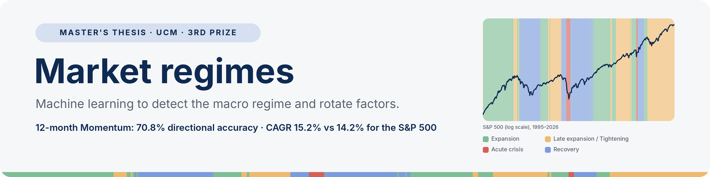
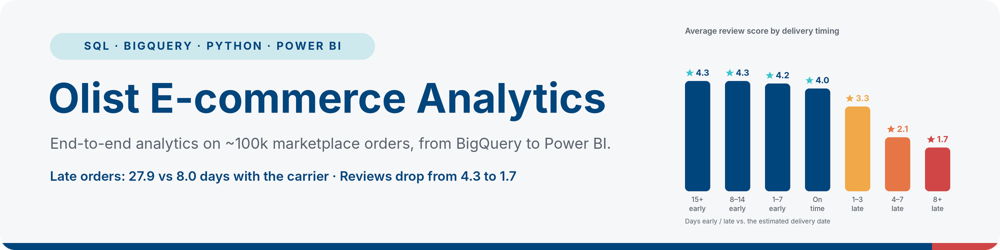
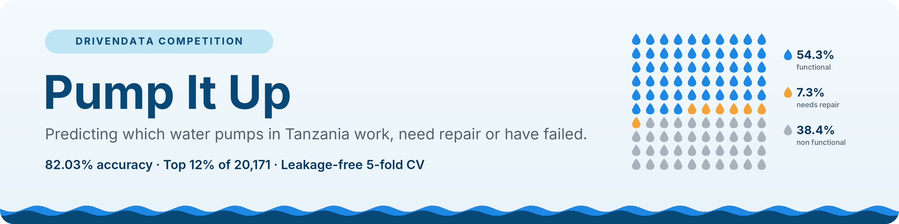

# Íñigo Ochoa, CFA

**CFA Charterholder · MSc in Data Science, Universidad Complutense de Madrid · Spain**

I am moving from finance into data science, with a focus on financial services and fintech. My projects explore how machine learning and data analysis can support financial and business decisions.

## Featured projects

My master's thesis at UCM (3rd prize in the scholarship competition): a two-layer machine learning pipeline that detects market regimes, predicts factor returns and builds an equity portfolio.

- Methods: k-means clustering, Random Forest, SHAP and walk-forward backtesting.
- Implementation: a reproducible Python pipeline and a FastAPI service.
- Results: only 12-month Momentum shows significant directional accuracy (70.8%, p = 0.0011). The core-satellite portfolio beat SPY (CAGR 15.2% vs 14.2%), with a small advantage concentrated after 2020. Market regimes add no incremental signal to the factor prediction layer.

[See the project and results →](https://github.com/inigoochoa/tfm-inigo-ochoa-UCM#main-results)

End-to-end analysis of ~100,000 orders from a Brazilian marketplace, from data modelling to recommendations for management.

- Data: an analytical layer in BigQuery (raw → staging → analytics) with a dimensional model and data quality checks.
- Analysis: keeping the delivery promise matters more to customer satisfaction than delivery speed. For the same delivery time, late orders score 1.0–1.8 points lower.
- Deliverables: a two-page Power BI dashboard and four business recommendations.

[See the key findings →](https://github.com/inigoochoa/olist-ecommerce-analytics#key-findings)

Multiclass classification project for the DrivenData competition, combining data preparation, leakage-free feature engineering and a model ensemble.

- Models: soft-voting ensemble of Random Forest, LightGBM and XGBoost.
- Methodology: target-ratio features fitted inside each training fold, stratified 5-fold cross-validation and experiment tracking with MLflow.
- Result: **82.03%** leaderboard accuracy (top 12% of 20,171), with 81.53% ± 0.36% in cross-validation.

[See the methodology →](https://github.com/inigoochoa/pump-it-up-competition)

Free, open-source NumPy course inspired by StrataScratch's interactive courses: Jupyter notebooks as the content source, plus a website that runs real NumPy in the browser (via Pyodide) with instant, automatic feedback — no backend required.

- Content: 6 modules, 33 lessons, 58 exercises with immediate feedback.
- Stack: Python/nbformat to generate the notebooks, Astro + React + Pyodide for the website.

[Try it live →](https://numpy.inigoochoa.com)

## Tools used in these projects

**Machine learning:** Python · pandas · NumPy · scikit-learn · LightGBM · XGBoost · SHAP · MLflow · FastAPI

**Data & BI:** SQL · BigQuery · Power BI

## Career goal

I am looking for Data Scientist roles in financial services and fintech, where I can combine financial expertise and rigorous model evaluation to support better decisions.

[Connect on LinkedIn](https://www.linkedin.com/in/inigo-ochoa-gil/)
